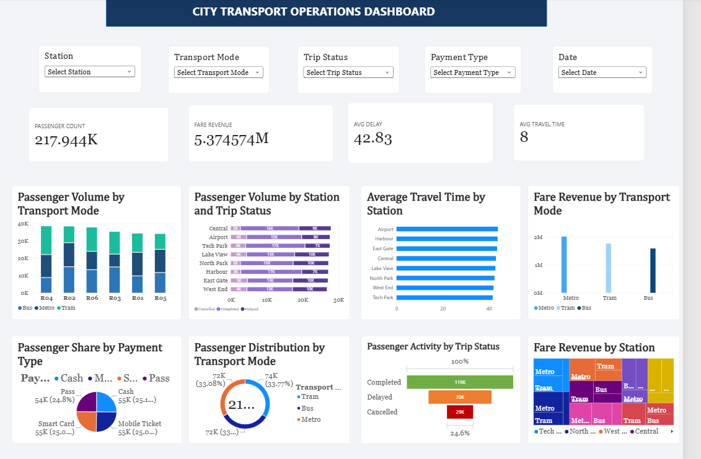
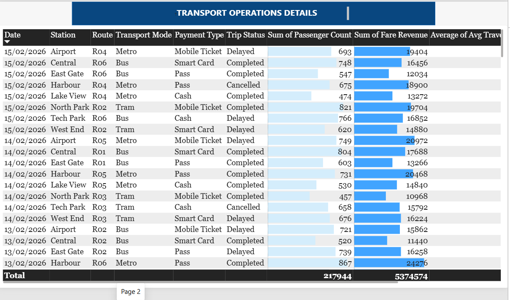
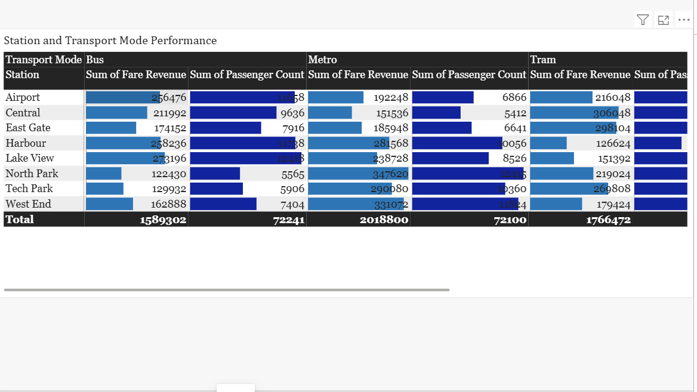

# city-transport-dashboard
City Transport Operations dashboard built in Power BI with DAX measures and data modeling to track key transit metrics
An interactive Power BI dashboard that analyzes city transport operations across buses, metro, and trams. It tracks passenger volume, fare revenue, delays, and travel time by station, route, transport mode, trip status, and payment type.
## Key Metrics
| Total Passengers | 217,944 |
| Total Fare Revenue | 5,374,574 |
| Average Delay | 42.83 |
| Average Travel Time | 8 |

## Dashboard Preview

### Page 1: City Transport Operations Dashboard

The overview page. Slicers for Station, Transport Mode, Trip Status, Payment Type, and Date filter the whole page. Four KPI cards sit above eight charts:

- Passenger Volume by Transport Mode
- Passenger Volume by Station and Trip Status
- Average Travel Time by Station
- Fare Revenue by Transport Mode
- Passenger Share by Payment Type (Cash, Mobile Ticket, Smart Card, Pass)
- Passenger Distribution by Transport Mode (Bus, Metro, Tram)
- Passenger Activity by Trip Status (Completed, Delayed, Cancelled)
- Fare Revenue by Station

### Page 2: Transport Operations Details

A detailed table with one row per record: Date, Station, Route, Transport Mode, Payment Type, Trip Status, Passenger Count, Fare Revenue, and Average Travel Time. Data bars make high and low values easy to compare, and the total row matches the KPI cards on Page 1.

### Page 3: Station and Transport Mode Performance

A matrix comparing fare revenue and passenger count for every station across Bus, Metro, and Tram, with totals for each mode.

## What the Dashboard Shows

- Metro earns the most fare revenue (about 2.02M), ahead of Tram (about 1.77M) and Bus (about 1.59M), even though passenger counts per mode are very close (about 72K each).
- Of all trips, 119K were completed, 70K were delayed, and 29K were cancelled.
- Passengers are spread almost evenly across the four payment types, at roughly 25% each.

## How to Use

1. Download `city-transport-dashboard.pbix`.
2. Open it in Power BI Desktop.
3. Use the slicers on Page 1 to explore by station, mode, trip status, payment type, and date.

## Tools Used

Power BI Desktop, DAX, Excel
